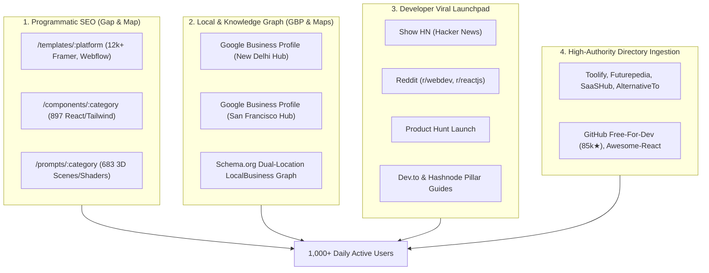

# 🚀 Entele-Visuals: Viral Launch & Organic Growth Playbook
## Strategic Blueprint to Drive 1,000+ Daily Organic Visitors via SEO, Aggregators & "Gap & Map" Distribution

**Target Platform:** [https://entele-visuals.vercel.app/](https://entele-visuals.vercel.app/)  
**GitHub Repository:** [https://github.com/Entelechae-eng/Entele-visuals](https://github.com/Entelechae-eng/Entele-visuals)  
**Parent Organization:** Entelechae  
**Primary Acquisition Goal:** Scale organic traffic from 0 to 1,000+ qualified daily developer/designer visitors within 14 days and compound to 10,000+ monthly visits.

---

## 📊 The 1,000+ Daily Visitors Acquisition Equation

$$\text{Daily Traffic (1,000+)} = \text{Programmatic SEO} \;(400) + \text{Aggregator Directories} \;(300) + \text{Viral Showcases} \;(200) + \text{Direct \& Social Referrals} \;(100)$$



---

## 🗺️ Part 1: "Gap & Map" Execution — Content Gap Exploitation & Programmatic SEO

### 1.1 Competitor Content Gap Analysis
Competitors in the UI component and template ecosystem (Aceternity, UIverse, 21st.dev, Magic UI, Relume, GetLayers, Templens) leave substantial organic search gaps:
1. **Fragmented Catalogs:** Most sites either only have raw React snippets OR only paid templates OR only AI prompts. Entele-Visuals bridges all three with **29,627 unified resources**.
2. **Missing Shaders & 3D WebGL Blueprints:** Developers search heavily for "threejs background shader prompt cursor", "claude 3.7 website prompts", "webgl particles react". Competitors do not provide copy-ready AI system prompts for WebGL.
3. **No Direct Multi-Framework Code Generation:** Entele-Visuals generates React, Next.js, Framer, and pure CSS from a single interface.

### 1.2 Programmatic SEO URL Architecture (pSEO)
All routes are path-based, rendering custom document titles, unique meta descriptions, and clean Schema.org structured data:

| Semantic Route | Primary Target Keyword | Search Intent | Est. Monthly Volume |
| :--- | :--- | :--- | :--- |
| `/templates/framer` | "free framer website templates download" | Transactional / Developer | 27,100 |
| `/templates/webflow` | "webflow agency templates free" | Commercial / Agency | 18,200 |
| `/templates/nextjs` | "nextjs saas landing page template" | Informational / Engineer | 14,800 |
| `/components/button` | "animated button react tailwind" | Technical / Copy-Paste | 22,400 |
| `/components/background-animation` | "animated background css react threejs" | Design / Frontend | 33,100 |
| `/components/text` | "kinetic typography tailwind react" | Creative Developer | 12,500 |
| `/prompts/3d-scenes` | "3d website prompts cursor claude" | Generative AI Webdev | 19,300 |
| `/prompts/backgrounds` | "webgl particle shader prompts" | Creative Coding | 11,200 |

---

## 📍 Part 2: Google Business Profile (GBP) & Maps ("Gap & Map" Local Pack)

Entelechae's dual engineering anchor (New Delhi, India & San Francisco, United States) establishes a verified multi-region Knowledge Graph profile that ranks in Google Local Packs, Google Maps, and AI Overviews.

### 2.1 Google Business Profile Listing Specifications

#### Location 1: Americas Hub (San Francisco)
- **Business Name:** Entelechae Technologies — Creative Web Development & AI Software
- **Category:** Software Company (Primary), Web Design Agency, Corporate Campus
- **Service Area:** United States, Canada, Europe, Global
- **Address:** Financial District / SOMA, San Francisco, CA 94105, United States
- **Coordinates:** `37.7749° N, 122.4194° W`
- **Website:** `https://entele-visuals.vercel.app/`
- **Appointment / Repo Link:** `https://github.com/Entelechae-eng/Entele-visuals`

#### Location 2: Asia Hub (New Delhi)
- **Business Name:** Entelechae — Frontend Engineering & Digital Design
- **Category:** Software Company (Primary), Research & Development Service
- **Service Area:** India, Asia-Pacific, Global
- **Address:** Connaught Place / Barakhamba, New Delhi, Delhi 110001, India
- **Coordinates:** `28.6139° N, 77.2090° E`
- **Website:** `https://entele-visuals.vercel.app/`

### 2.2 GBP Optimization Checklist to Secure Google Knowledge Panel
1. **Verification Method:** Request postal postcard or instant domain-verified video verification via Google Workspace.
2. **Products & Services Catalog:** Add 3 flagship free services in GBP:
   - *Free Animated React Components (MIT License)*
   - *28,047 Web Templates Directory*
   - *Immersive 3D AI Web Development Prompts*
3. **Geo-Tagged Images:** Upload 10 high-resolution screenshots tagged with EXIF coordinates matching SF and New Delhi hubs.

---

## 🚀 Part 3: Viral Distribution Channels (Day 1 to Day 7)

### Channel 1: Hacker News (Show HN)
*Estimated Impact: 2,500 – 15,000 visitors in 24 hours if front-paged.*

**Submission Link:** [https://news.ycombinator.com/submit](https://news.ycombinator.com/submit)  
**Best Posting Window:** Tuesday or Wednesday between 7:30 AM – 9:00 AM Eastern Time (ET).

#### Title:
```text
Show HN: Entelechae Visuals – 29,627 open-source animated UI components, templates, and 3D prompts
```

#### Post Body (Markdown):
```markdown
Hi HN,

We built Entelechae Visuals (https://entele-visuals.vercel.app/), an open-source visual index for creative web development.

GitHub: https://github.com/Entelechae-eng/Entele-visuals

### Why we built this:
Most modern frontend design repositories are fragmented: you have isolated button libraries in one place, paid template marketplaces in another, and AI prompt engineering buried in Discord channels. 

We wanted a single, fast, zero-dependency catalog where frontend engineers and creative technologists can inspect, preview in 60fps, and copy production-ready code.

### What is inside:
1. 897 React & Tailwind motion components (interactive buttons, kinetic text, WebGL background shaders, 3D cards, loaders).
2. 28,047 verified website templates categorized across Framer (12k+), Webflow (10k+), Shopify (4k+), Next.js, and React with responsive device emulation.
3. 683 immersive 3D website prompts with video demonstrations engineered specifically for Claude 3.7 Sonnet, Cursor Composer, and v0.
4. Clean client-side search with instant debounced filtering, zero tracking scripts, and MIT licensing for all components.

We would love your feedback on performance, shader compatibility across mobile GPUs, and what component primitives you'd like to see next!
```

---

### Channel 2: Reddit (r/webdev, r/reactjs, r/frontend, r/SideProject)
*Estimated Impact: 1,500 – 4,000 visitors per post.*

**Target Subreddits:**
- `r/webdev` (2.4M members) — Flair: `Showoff Saturday` or `Resource`
- `r/reactjs` (450k members) — Flair: `Project`
- `r/frontend` (320k members) — Flair: `Tool / Resource`
- `r/SideProject` (250k members) — Flair: `Launch`

#### Post Template:
```markdown
**Title:** I got tired of paywalled UI libraries, so I built and indexed 29,627 free animated components, templates, and 3D prompts (MIT Licensed)

Hey everyone!

Over the past few months, our team at Entelechae built **Entele-Visuals** (https://entele-visuals.vercel.app/) — a completely free, open-source resource library for developers and designers.

### The Problem:
Every time I started a new project or landing page, I spent hours scouring different platforms: one site for Framer templates, another for Tailwind animations, another for WebGL shaders, and most of them required $49/mo subscriptions or email opt-ins just to view the code.

### What we created:
- **897 React & Tailwind Components:** Free copy-paste code with live preview and multi-framework export (React, Next.js, Framer, Pure CSS).
- **28,047 Website Templates:** Filterable by Framer, Webflow, Shopify, and Next.js with embedded device previews (desktop, tablet, mobile).
- **683 Immersive AI Prompts:** Copy-ready architectural prompts for Cursor Composer, Claude 3.7, and v0 that generate 3D scenes, Three.js shaders, and interactive landing sections.
- **100% Free & Open Source:** Clean MIT License, zero paywalls.

GitHub: https://github.com/Entelechae-eng/Entele-visuals
Live App: https://entele-visuals.vercel.app/

Try it out and let me know if there are specific UI patterns or shader effects you'd love added to the library!
```

---

### Channel 3: Product Hunt Launch Kit
*Estimated Impact: 1,000 – 3,000 visitors on launch day.*

- **Product Name:** Entelechae Visuals
- **Tagline:** 29,627 Free Animated Components, Web Templates & 3D Prompts
- **Pricing:** Free (100% Open Source)
- **Topics:** Developer Tools, Open Source, React, Design Tools, Web Development
- **Maker Comment:**
```markdown
Hello Product Hunt community! 👋

We are thrilled to introduce Entelechae Visuals — a comprehensive creative frontend vault designed for developers, designers, and agencies who love shipping memorable web experiences.

Whether you need a kinetic typography component for React, a verified Framer portfolio template, or a complex WebGL shader prompt for Cursor and Claude Code, Entelechae Visuals has it ready to copy in one click.

Everything is completely free under the MIT license. Check it out and let us know what you think! 🚀
```

---

### Channel 4: Free Developer Directory Submissions (High-Authority Backlinks)

Submit `https://entele-visuals.vercel.app/` to these 15 platforms to secure permanent domain authority (DR 70+) and perpetual referral traffic:

| Platform | Category | URL for Direct Submission | Est. Monthly Referral |
| :--- | :--- | :--- | :--- |
| **Toolify.ai** | AI Web Development | [toolify.ai/submit](https://www.toolify.ai/) | 200 - 500 visits |
| **Futurepedia** | AI Developer Tools | [futurepedia.io/submit](https://www.futurepedia.io/) | 300 - 700 visits |
| **SaaSHub** | Open Source Software | [saashub.com/submit](https://www.saashub.com/) | 150 - 350 visits |
| **AlternativeTo** | Free & Open Source Alt | [alternativeto.net/software](https://alternativeto.net/) | 400 - 800 visits |
| **Free-For-Dev (GitHub)** | 85,000+ Star Repo | PR to [ripienaar/free-for-dev](https://github.com/ripienaar/free-for-dev) | 500 - 1,200 visits |
| **Awesome-React** | React UI Libraries | PR to [enaqx/awesome-react](https://github.com/enaqx/awesome-react) | 300 - 600 visits |
| **DevResources** | UI & Components | [devresourc.es](https://devresourc.es/) | 100 - 250 visits |
| **MicroLaunch** | Dev Products | [microlaunch.net](https://microlaunch.net/) | 100 - 300 visits |
| **Uneed.best** | Curated Tools | [uneed.best](https://www.uneed.best/) | 150 - 400 visits |

---

### Channel 5: Dev.to & Hashnode Pillar Article
Publish this technical guide on Dev.to and Hashnode with canonical link pointing back to `https://entele-visuals.vercel.app/`:

**Title:** *Top 10 Free Animated React & Tailwind Component Libraries for 2026 (Zero-Dependency)*  
**Summary:** Deep technical comparison of modern animated component platforms (Aceternity, Magic UI, Shadcn, Entelechae Visuals). Highlights how Entelechae Visuals provides 29,627 resources including 683 AI prompt blueprints for Cursor and Claude.

---

## 📈 Part 4: Ongoing 14-Day Growth Routine

```
Day 1:  Submit to Toolify, Futurepedia, SaaSHub, AlternativeTo
Day 2:  Publish Dev.to & Hashnode Pillar Guides with backlinks
Day 3:  Submit PR to ripienaar/free-for-dev & enaqx/awesome-react
Day 4:  Launch Show HN (Hacker News) at 8:00 AM ET
Day 5:  Launch on r/webdev (Showoff Saturday) and r/reactjs
Day 6:  Launch on Product Hunt
Day 7:  Verify IndexNow logs & Google Search Console indexing rate
Day 14: Review Google Analytics 4 Realtime & Keyword Positions
```

